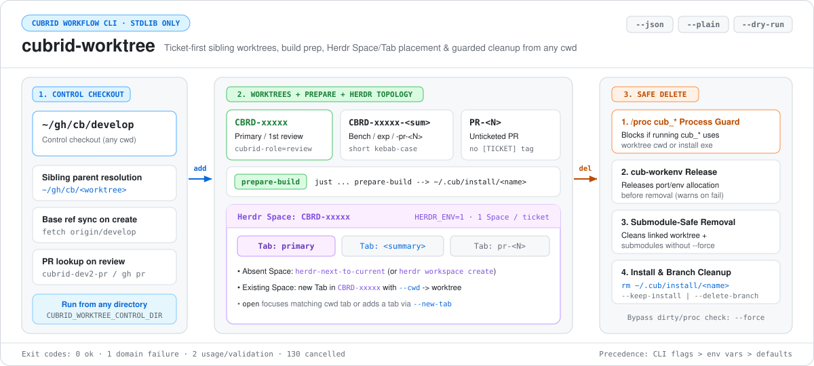

<div align="center">

<picture>
  <source media="(prefers-color-scheme: dark)" srcset="assets/readme/hero-dark.svg" />
  <source media="(prefers-color-scheme: light)" srcset="assets/readme/hero-light.svg" />
  
</picture>

# cubrid-worktree

**Ticket-first Git worktree, PR review checkout, build preparation, and [Herdr](https://herdr.dev) workspace/tab manager for CUBRID development.**

Python 3.10+ stdlib only · Run from **any directory** · Machine-readable `--json` and `--plain` output

<p>
  <a href="#why-this-exists">Why this exists</a> •
  <a href="#naming-conventions">Naming</a> •
  <a href="#herdr-topology">Herdr topology</a> •
  <a href="#installation">Installation</a> •
  <a href="#usage">Usage</a> •
  <a href="#configuration">Configuration</a> •
  <a href="#exit-codes">Exit codes</a>
</p>

</div>

---

Run from **any directory** — `cubrid-worktree` resolves your CUBRID control checkout (default `~/gh/cb/develop`) automatically, creates sibling worktrees under its parent directory (default `~/gh/cb/`), prepares the build environment, and opens the corresponding Herdr Space or Tab.

## Why this exists

Multi-branch CUBRID engineering quickly outgrows ad-hoc `git worktree` commands—especially when juggling parallel ticket work, PR reviews, submodules, local installations, and terminal multiplexers across AI-agent sessions.

`cubrid-worktree` standardizes the full lifecycle around a single source of truth:

- **Ticket-first worktree naming**: Resolves `~/gh/cb/develop` from any `cwd` and enforces deterministic sibling directories (`CBRD-xxxxx`, `CBRD-xxxxx-<summary>`, `CBRD-xxxxx-pr-<N>`, `PR-<N>`) so humans and agents always know where a branch lives.
- **Herdr Space/Tab topology**: Maps each ticket to **one Herdr Space** (`CBRD-xxxxx` or `PR-<N>`) and attaches derived experiments, benchmarks, and additional PR checkouts as **Tabs** inside that Space.
- **Guarded `delete` with `/proc` inspection**: Scans `/proc` for running `cub_*` processes referencing the worktree or its installation before tearing anything down, preventing accidental deletion under live database servers.
- **Automatic `cub-workenv` & install cleanup**: Releases `cub-workenv` allocations prior to removal (warning if reset fails), handles linked worktree submodules cleanly without `--force`, and removes `~/.cub/install/<worktree-name>` unless `--keep-install` is passed.

## Naming conventions

| Use case | Directory & branch name | Notes |
| --- | --- | --- |
| Primary PR / ticket worktree | `CBRD-xxxxx` | Default base `origin/develop` |
| Non-PR tests, benchmarks, experiments, or derived work | `CBRD-xxxxx-<summary>` | Allowed whether or not `CBRD-xxxxx` exists |
| First PR review for a ticket | `CBRD-xxxxx` | Used when `CBRD-xxxxx` is unoccupied; tagged `cubrid-role=review` |
| Additional PR review for an occupied ticket | `CBRD-xxxxx-pr-<N>` | Automatic fallback when `CBRD-xxxxx` already exists |
| Unticketed PR review | `PR-<N>` | When the PR title has no `[TICKET-123]` tag |

Constraints:
- `<summary>` must be short kebab-case (`[A-Za-z0-9][A-Za-z0-9._-]*`), must not contain `/`, and must not include a second distinct ticket key.
- Forward-only: existing legacy worktrees and branches do not need to be renamed.

## Herdr topology

When running inside Herdr (`HERDR_ENV=1`):
- Each ticket gets **one Herdr Space** labeled `CBRD-xxxxx` (or `PR-<N>` for unticketed reviews).
- If that Space does not exist, `cubrid-worktree` creates it via `herdr-next-to-current` (falling back to `herdr workspace create`), and renames the initial tab to `<summary>` when starting with a derived worktree.
- If that Space already exists, `cubrid-worktree` creates a **new Tab** inside the existing `CBRD-xxxxx` Space with `--cwd` set to the worktree and labeled `<summary>` (or `pr-<N>`).

## Installation

Install from a local clone (recommended for development and `just` integration):

```bash
git clone https://github.com/vimkim/cubrid-worktree.git ~/gh/cubrid-worktree
cd ~/gh/cubrid-worktree
just install    # alias for `just sync`; installs via `uv tool install --reinstall .`
```

Or install directly from GitHub:

```bash
uv tool install git+https://github.com/vimkim/cubrid-worktree
```

## Usage

All subcommands support `--json` (structured envelope on stdout), `--plain` (tab-separated lines), and `--dry-run` (`-n`, mutating commands) for reliable scripting and agent automation.

### Create & derived worktrees

```bash
# Primary ticket worktree (fetches origin/develop, prepares build, opens Herdr Space)
cubrid-worktree create CBRD-28099

# Non-PR benchmark/test/experiment worktree (works with or without CBRD-28099)
cubrid-worktree create CBRD-28099-bench
cubrid-worktree create CBRD-28099 --summary 11.4 --base origin/release/11.4
```

### PR review checkouts

```bash
# PR review worktree (by number, URL, interactive fzf picker, or all requested)
cubrid-worktree review 7887
cubrid-worktree review https://github.com/CUBRID/cubrid/pull/7887
cubrid-worktree review --interactive
cubrid-worktree review --all
```

### Open & list worktrees

```bash
# Open an existing worktree in Herdr using the ticket Space/Tab rule
cubrid-worktree open CBRD-28099-bench

# List worktrees (optionally filtered by ticket)
cubrid-worktree list
cubrid-worktree list CBRD-28099 --json
```

### Safe delete & cleanup

```bash
# Delete a clean linked worktree (safely handles submodules without --force)
cubrid-worktree delete CBRD-28099-bench --dry-run --json
cubrid-worktree delete CBRD-28099-bench --json
cubrid-worktree delete CBRD-28099-bench --delete-branch --json
cubrid-worktree delete CBRD-28099-bench --keep-install
cubrid-worktree delete CBRD-28099-bench --force --json
```

`delete` checks `/proc` for running `cub_*` processes that reference the
worktree or its installation. Stop the listed processes before deleting, or
pass `--force` to bypass the check. The command attempts to release
`cub-workenv` allocations before removing the worktree and warns if the reset
could not run. It removes the default `~/.cub/install/<worktree-name>` directory
after worktree removal. Pass `--keep-install` to preserve it.

## Configuration

Precedence: CLI flags > environment variables > defaults.

| Environment variable | Legacy fallback | Default |
| --- | --- | --- |
| `CUBRID_WORKTREE_CONTROL_DIR` | `CUBRID_REVIEW_CONTROL_DIR` | `~/gh/cb/develop` |
| `CUBRID_WORKTREE_PARENT` | `CUBRID_REVIEW_WORKTREE_PARENT` | `<control_dir>/..` |
| `CUBRID_WORKTREE_REPO` | — | `CUBRID/cubrid` |
| `CUBRID_WORKTREE_PREPARE_JUSTFILE` | `CUBRID_REVIEW_JUSTFILE` | `${MY_CUBRID:-~/my-cubrid}/cubrid-justfiles/justfile` |
| `CUBRID_WORKTREE_PREPARE_CMD` | — | Runs `just --justfile ... prepare-build` when available |
| `CUBRID_WORKTREE_REVIEW_CANDIDATES_CMD` | — | `cubrid-dev2-pr --json --requested-only` if on `PATH`, else `gh pr list` |

## Exit codes

| Code | Meaning |
| --- | --- |
| `0` | Success |
| `1` | Domain failure (git/gh/prepare/herdr failure, conflict without `--reuse`, missing worktree) |
| `2` | Invalid usage or validation error (bad target name, invalid PR selector, conflicting flags) |
| `130` | Cancelled (interactive selection cancelled or interrupted) |
